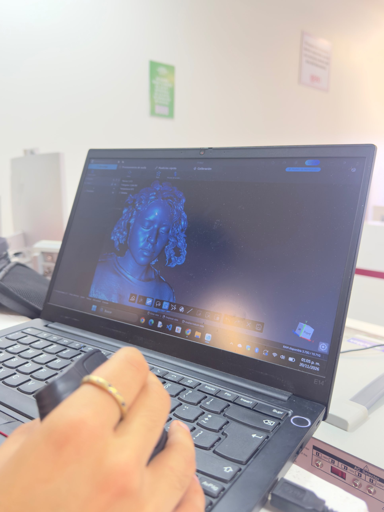
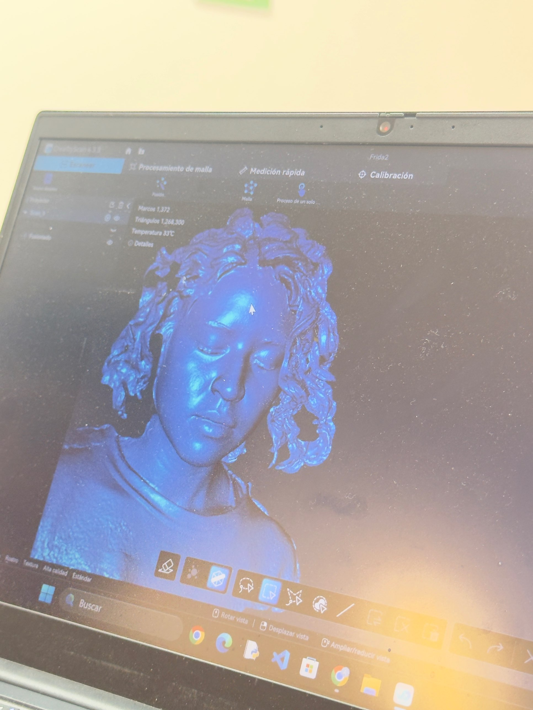
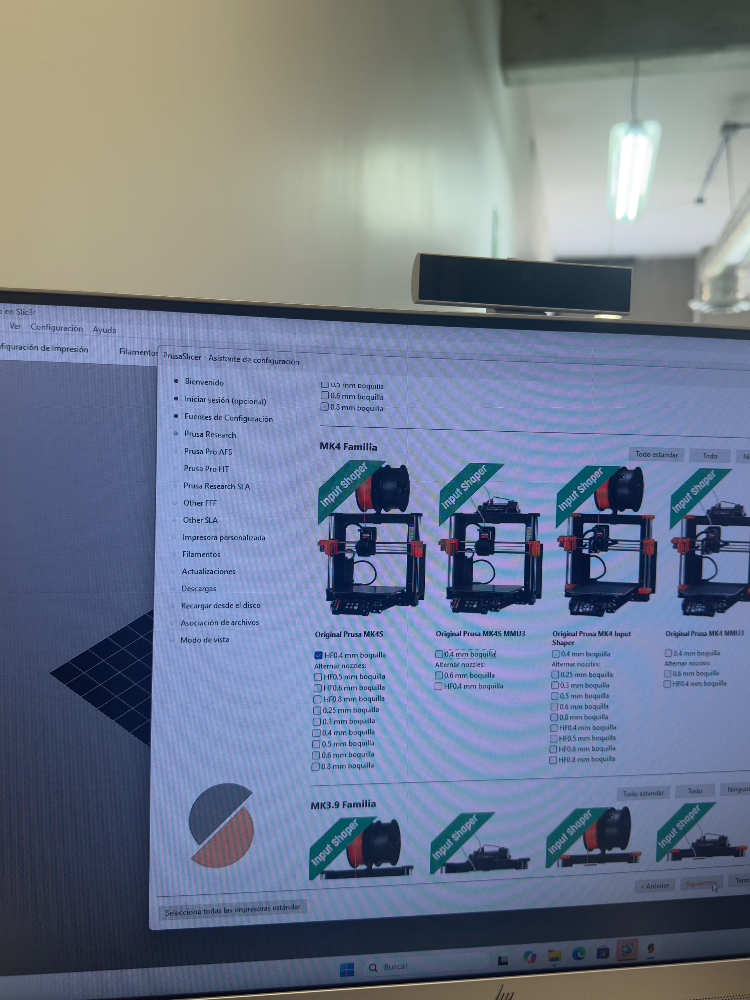
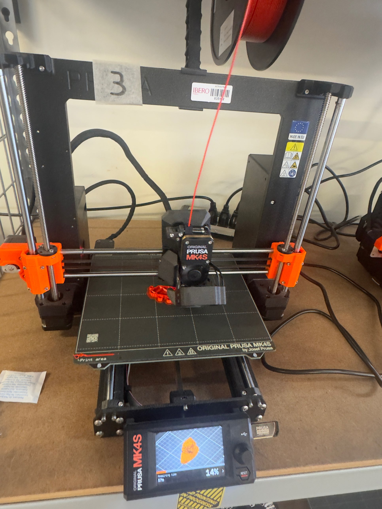
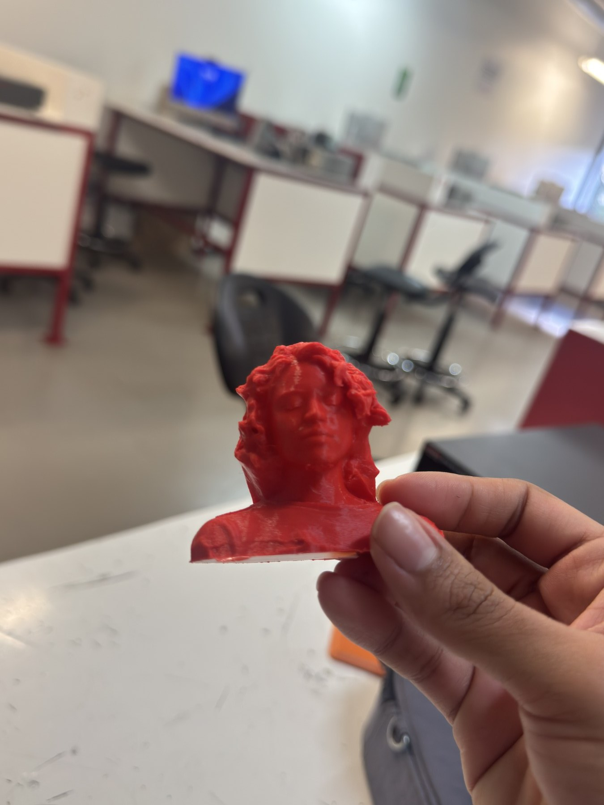

# Escaneo e impresión 3D

**Autor:** Frida Velazquez Anaya

**Fecha:** Viernes 20 de noviembre de 2026

## Qué hice

Escaneé en 3D un busto y después lo imprimí. Primero me escanearon con el escáner Creality, luego arreglé el modelo en la app Creality Scan, lo preparé en PrusaSlicer y al final lo imprimí en una Prusa MK4S.

Archivos del proyecto:

- Modelo escaneado: [`modelos/Frida_base_plana.stl`](modelos/Frida_base_plana.stl)
- Archivo que se imprimió (producto final de PrusaSlicer): [`impresion/Frida_Base2.bgcode`](impresion/Frida_Base2.bgcode)

## Paso a paso

### 1. Escaneo

En el lab de mecatrónica me enseñaron a usar el escáner Creality (CR-Scan Ferret). Se conecta por USB a la laptop y el escaneo se ve en la pantalla mientras se captura.

### 2. Crear la malla en Creality Scan

Pasé el escaneo a la app Creality Scan y ahí hice la malla. Después lo exporté como STL con la base plana.

### 3. Preparar el archivo en PrusaSlicer

Abrí el STL en PrusaSlicer. Lo primero fue configurar la impresora con el asistente: una Original Prusa MK4S con boquilla de 0.4 mm.

Luego escalé la pieza al 15 %, para que quedara no tan grande. Después le puse soportes, porque el cabello y la barbilla quedan en el aire y sin soportes se caerían al imprimir. Por último revisé la vista previa por capas para ver cómo se iba a imprimir.

### 4. Imprimir

Guardé el archivo laminado ([`Frida_Base2.bgcode`](impresion/Frida_Base2.bgcode)) en una USB, lo puse en la impresora número 3 y empecé a imprimir.

## Resultado

Así quedó la pieza ya impresa y sin soportes.

## Dificultades

- Aprender a usar el escáner.
- No supe cómo escalar la pieza al principio.
- No sabía cómo poner los soportes.
- No sabía cómo hacer la malla en la app.
- No sabía que necesitaba PrusaSlicer. Pensé que con el STL bastaba, pero la impresora necesita el archivo laminado que se genera ahí.

## Declaración de uso de IA

- **Herramienta utilizada:** Claude, modelo Claude Sonnet 5.5.
- **Qué le pedí:** Ayuda para organizar y redactar la descripción de mi proceso de escaneo e impresión 3D a partir de mis notas y fotos.
- **Qué modifiqué o rechacé de su respuesta, y por qué:** El proceso, los parámetros y las fotos son de mi trabajo en el laboratorio; la IA solo me ayudó a ordenarlo y redactarlo. Revisé el contenido contra lo que realmente hice, cambié el texto para que quedara más sencillo y en primera persona, y escogí qué fotos y archivos incluir.
